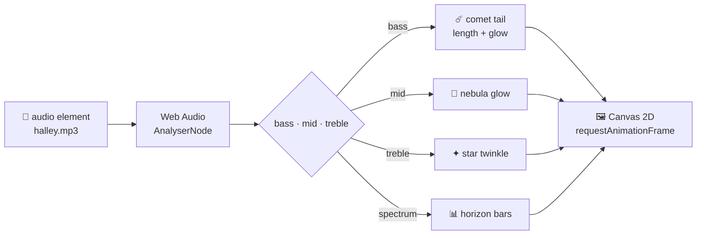

<div align="center">


<br />

**ฉากท้องฟ้ายามค่ำคืนที่ดาวหางเต้นไปตามเพลง "ดาวหางฮัลเลย์"**<br />
<sub>A night sky where Halley's comet glides, glows and dances to the music.</sub>

<br />


<sub>✦ intro by <b>Pma.Dev</b> ✦</sub>

</div>

---

## 🌠 Preview

<table>
  <tr>
    <td width="50%"></td>
    <td width="50%"></td>
  </tr>
  <tr>
    <td align="center"><sub><b>Intro</b> — แตะเพื่อเริ่ม</sub></td>
    <td align="center"><sub><b>The sky</b> — ดาวหางเต้นตามจังหวะ</sub></td>
  </tr>
</table>

## ✨ Features

| | |
|---|---|
| ☄️ **Living comet** | ดาวหางลอยเป็นวงโค้งข้ามฟ้าแบบนุ่มๆ หางสีฟ้าโค้งตามทางที่ผ่าน ฝุ่นที่หางลอยวนเป็นเกลียว |
| 🎵 **Reacts to the music** | เสียงเบสทำให้หางยาวขึ้นและสว่างขึ้น ความเร็วค่อยๆ ปรับตามพลังของเพลง |
| 🌌 **Breathing sky** | ดาวกะพริบตามเสียงแหลม เนบิวลาเรืองแสงตามเสียงกลาง ดาวตกโผล่บ่อยขึ้นตอนเพลงดัง |
| 📊 **Horizon visualizer** | แท่งคลื่นเสียงเรืองแสงขึ้นจากหลังเนินเขา |
| 🎬 **Pma.Dev intro** | ตัวอักษรลอยขึ้นทีละตัว แสงวิ่งผ่าน ดาวหางโคจรรอบโลโก้ — แตะครั้งเดียว เพลงเริ่มทันที |
| 📱 **Responsive** | Full-screen ทุกขนาดจอ รองรับจอ HiDPI และ `prefers-reduced-motion` |

## 🚀 Quick start

```bash
git clone https://github.com/MrPusitCH/StarHalley.git
cd StarHalley
npm install
npm run dev
```

เปิด **http://localhost:3000** แล้วแตะหน้าจอเพื่อเริ่ม

## 🎧 Add the song

ไฟล์เพลง**ไม่ได้รวมอยู่ใน repo** เพราะเป็นเพลงที่มีลิขสิทธิ์ ให้วางไฟล์ของคุณเองไว้ที่:

```
public/music/halley.mp3
```

`.gitignore` ถูกตั้งไว้แล้ว ไฟล์เพลงจะไม่ถูก commit ขึ้นไปโดยไม่ตั้งใจ

## 🎮 Controls

| Key / Action | What it does |
|---|---|
| แตะหน้าจอ / `Enter` / `Space` บนหน้า intro | เข้าสู่ฉากและเริ่มเล่นเพลง |
| `Space` | เล่น / หยุดชั่วคราว |
| ลากแถบเวลา | เลื่อนไปยังตำแหน่งในเพลง |

## 🛰️ How it works



ทุกอย่างวาดสดบน `<canvas>` ทีละเฟรม ไม่มีรูปภาพหรือวิดีโอเลย ค่าพลังเสียงถูกทำให้นุ่มก่อนนำไปใช้ ดาวหางจึงเคลื่อนไหลลื่น ไม่กระตุกตามจังหวะ

## 📁 Project structure

```
StarHalley/
├── app/
│   ├── layout.tsx        # font (Mitr) + metadata
│   ├── page.tsx          # renders the scene
│   └── globals.css       # player UI + Pma.Dev intro animations
├── components/
│   └── CometScene.tsx    # canvas scene, audio analyser, player
├── public/music/         # put halley.mp3 here (git-ignored)
└── docs/                 # README banner + screenshots
```

## 💫 Credits

- 🎤 เพลง **ดาวหางฮัลเลย์** — **fellow fellow** (ไม่ได้รวมไว้ใน repo · สนับสนุนศิลปินบนแพลตฟอร์มสตรีมมิ่งที่ถูกลิขสิทธิ์)
- ✨ Intro & design — **Pma.Dev**
- ☄️ แรงบันดาลใจจาก 1P/Halley ดาวหางที่โคจรกลับมาให้เห็นทุก ~76 ปี — ครั้งหน้าคือปี **2061**

<div align="center">
<br />
<sub>Made with ☄️ under the night sky</sub>
</div>
