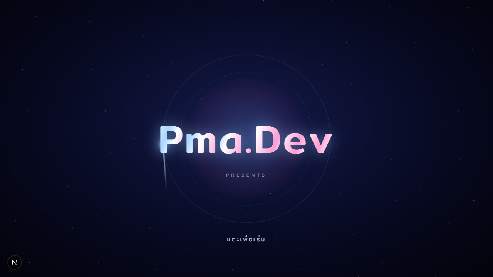
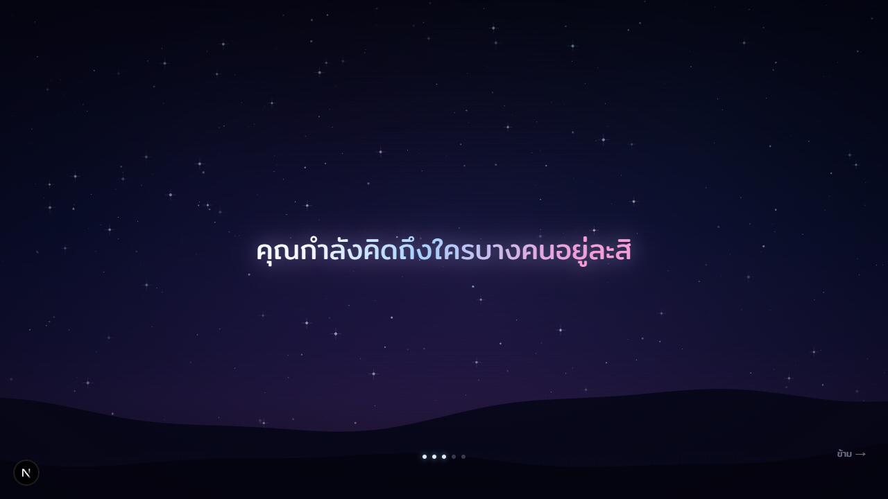
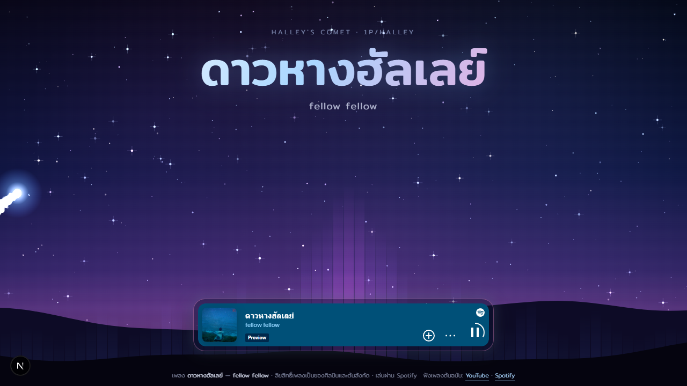
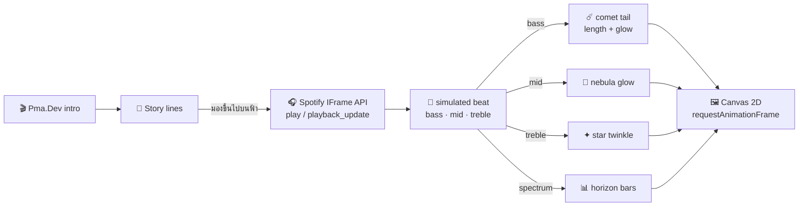

<div align="center">



<br />

**ฉากท้องฟ้ายามค่ำคืนที่ดาวหางเต้นไปตามเพลง "ดาวหางฮัลเลย์"**<br />
<sub>A night sky where Halley's comet glides, glows and dances to the music.</sub>

<br />


<sub>✦ intro by <b>Pma.Dev</b> ✦</sub>

</div>

---

## 🌠 Preview

<table>
  <tr>
    <td width="33%"></td>
    <td width="33%"></td>
    <td width="33%"></td>
  </tr>
  <tr>
    <td align="center"><sub><b>1 · Intro</b> — แตะเพื่อเริ่ม</sub></td>
    <td align="center"><sub><b>2 · Story</b> — คุณกำลังคิดถึงใครบางคนอยู่ละสิ</sub></td>
    <td align="center"><sub><b>3 · The sky</b> — ดาวหางมาพร้อมเพลง</sub></td>
  </tr>
</table>

## ✨ Features

| | |
|---|---|
| 🎬 **Pma.Dev intro** | ตัวอักษรลอยขึ้นทีละตัว แสงวิ่งผ่าน และดาวหางโคจรรอบโลโก้ |
| 💭 **Story before the song** | ข้อความเล่าเรื่องค่อยๆ ปรากฏทีละบรรทัดใต้ท้องฟ้ามืด ก่อนจะชวนให้ *มองขึ้นไปบนฟ้า* |
| 🎧 **Spotify playback** | เพลงเล่นผ่าน Spotify Embed อย่างถูกลิขสิทธิ์ ไม่มีไฟล์เพลงอยู่ใน repo |
| ☄️ **Living comet** | ดาวหางลอยเข้ามาตอนเพลงเริ่ม หางโค้งตามทางที่ผ่าน ฝุ่นที่หางลอยวนเป็นเกลียว |
| 🌌 **Breathing sky** | ดาวกะพริบ เนบิวลาเรืองแสง ดาวตกพาดผ่าน และแท่งคลื่นเสียงเรืองแสงจากหลังเนินเขา |
| 📱 **Responsive** | Full-screen ทุกขนาดจอ รองรับจอ HiDPI และ `prefers-reduced-motion` |

## 🚀 Quick start

```bash
git clone https://github.com/MrPusitCH/StarHalley.git
cd StarHalley
npm install
npm run dev
```

เปิด **http://localhost:3000** แล้วแตะหน้าจอเพื่อเริ่ม — ไม่ต้องเตรียมไฟล์เพลงใดๆ

## 🎧 About the music

เพลงเล่นผ่าน **Spotify Embed** ของเพลง [ดาวหางฮัลเลย์ — fellow fellow](https://open.spotify.com/track/56wDFSIa9Tr7zbEXUVMwjP)

- 🔓 **ล็อกอิน Spotify** อยู่ในเบราว์เซอร์ → ฟังได้เต็มเพลง
- 🔒 **ไม่ได้ล็อกอิน** → Spotify เปิดให้ฟังตัวอย่างประมาณ 30 วินาที
- ถ้าเบราว์เซอร์บล็อกการเล่นอัตโนมัติ เว็บจะบอกให้กดปุ่ม ▶ บนการ์ด Spotify

## 🎮 Controls

| Key / Action | What it does |
|---|---|
| แตะหน้าจอ / `Enter` / `Space` บนหน้า intro | เริ่มเรื่องเล่า |
| แตะ / `Space` ระหว่างเรื่องเล่า | ไปบรรทัดถัดไป |
| `Esc` / ปุ่ม **ข้าม →** | ข้ามเรื่องเล่า |
| ปุ่ม **มองขึ้นไปบนฟ้า ✦** | เผยท้องฟ้าและเริ่มเพลง |
| `Space` | เล่น / หยุดชั่วคราว |

## 🛰️ How it works



ทุกอย่างวาดสดบน `<canvas>` ทีละเฟรม Spotify ไม่เปิดให้เว็บอื่นอ่านเสียงของเพลงได้ ฉากจึงเต้นตาม**จังหวะจำลอง**ที่เริ่มและหยุดพร้อมเพลง ค่าพลังเสียงถูกทำให้นุ่มก่อนนำไปใช้ ดาวหางจึงเคลื่อนไหลลื่น ไม่กระตุก

## 📁 Project structure

```
StarHalley/
├── app/
│   ├── layout.tsx        # font (Mitr) + metadata
│   ├── page.tsx          # renders the scene
│   └── globals.css       # player card, story + Pma.Dev intro animations
├── components/
│   └── CometScene.tsx    # canvas scene, story, Spotify controller
└── docs/                 # README banner + screenshots
```

## 💫 Credits

- 🎤 เพลง **ดาวหางฮัลเลย์** — **fellow fellow** · ลิขสิทธิ์เป็นของศิลปินและต้นสังกัด · เล่นผ่าน [Spotify](https://open.spotify.com/track/56wDFSIa9Tr7zbEXUVMwjP)
- ✨ Intro & design — **Pma.Dev**
- ☄️ แรงบันดาลใจจาก 1P/Halley ดาวหางที่โคจรกลับมาให้เห็นทุก ~76 ปี — ครั้งหน้าคือปี **2061**

<div align="center">
<br />
<sub>Made with ☄️ under the night sky</sub>
</div>
